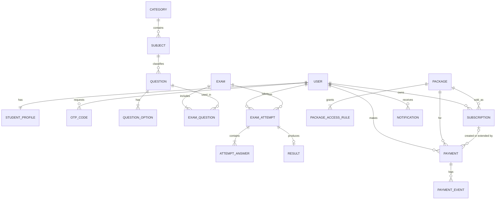

# Database Design — Online MCQ Examination Platform (Phase-1)

> Status: **Planning document.** Field lists are a design proposal; final names/types are fixed
> when Django models are written. Database: **PostgreSQL** (single, centralized).

---

## 1. Design principles

1. **PostgreSQL is the source of truth.** Clients never store authoritative data.
2. **Let the database enforce rules where it can:** `UNIQUE`, `CHECK`, `FOREIGN KEY`,
   `NOT NULL`. App-level validation is the first guard; DB constraints are the last guard.
3. **Money is `NUMERIC(12,2)`** (Django `DecimalField`) — never float.
4. **Marks are `NUMERIC(7,2)`** — negative marks like 0.25 must be exact.
5. **All timestamps `timestamptz` in UTC.**
6. **Every table has** `id` (BIGINT identity), `created_at`, `updated_at` (from a shared abstract
   base model). Public-facing identifiers that appear in URLs/payments use a `public_id` UUID
   so sequential IDs are not guessable where it matters (attempts, payments).
7. **Soft delete** (`is_active` / `deleted_at`) for content that past results depend on
   (questions, exams, packages). Hard delete only when nothing references the row.
8. **Snapshot what the past depends on.** An attempt stores the marks and order it was taken
   with, so later edits to an exam do not silently change old results.
9. **Designed for future expansion:** nullable FKs and enum fields that can grow
   (e.g. more payment providers, more roles) without schema rewrites.
10. **Bilingual content (Bangla + English).** Every admin-entered, user-visible text field is
    stored as a **pair of columns**: `<field>_bn` and `<field>_en` (see §2a).

---

## 2a. Bilingual field convention

| Rule | Detail |
|---|---|
| Naming | `name_bn` / `name_en`, `text_bn` / `text_en`, … In the tables below a field written as **`title`🌐** means *two columns* `title_bn` + `title_en`. |
| Required-ness | At least **one** of the pair is required (`CHECK (coalesce(title_bn,'') <> '' OR coalesce(title_en,'') <> '')`). Both may be required by business rules (e.g. `both`-language exams at publish time). |
| Fallback | API returns the requested language, falling back to the other if empty. |
| Normalization | All text NFC-normalized before save; digits stored as Western digits in numeric fields. |
| Search | `pg_trgm` GIN indexes on `*_bn` and `*_en` for the question bank (no Bangla stemmer in PostgreSQL FTS). |
| Slugs | ASCII only (from English title or admin-entered). |
| Not translated | Identifiers, numbers, money, timestamps, enum codes (enums are translated by the clients/`gettext`, never stored as display text). |

**Why paired columns instead of a separate translation table or JSON?**
- Exactly two languages are required → simplest queries, normal DB constraints and indexes per language.
- Easy for admins: two inputs/tabs per field.
- A third language later = add columns via migration (or switch to `django-modeltranslation`, which uses
  the same column pattern). Translation tables are more flexible but add a join to every content query —
  not worth it for two fixed languages.

Full localization rules: `LOCALIZATION.md`.

---

## 2. Entity overview (by module)

| Module | Tables |
|---|---|
| accounts | `users`, `student_profiles` |
| verification | `otp_codes`, `verification_tokens` |
| catalog | `categories`, `subjects` |
| questions | `questions`, `question_options` |
| exams | `exams`, `exam_questions` |
| attempts | `exam_attempts`, `attempt_answers` |
| results | `results` |
| subscriptions | `packages`, `package_access_rules`, `subscriptions` |
| payments | `payments`, `payment_events` |
| cms | `site_settings`, `announcements`, `faqs`, `pages`, `contact_messages` |
| notifications | `notifications` |
| audit | `audit_logs` |

(Table names shown without the Django app prefix for readability.)

---

## 3. Relationship diagram

```
users 1──1 student_profiles
otp_codes 1──0..1 verification_tokens   (no FK to users: an OTP exists before the user does)

categories 1──* subjects 1──* questions 1──* question_options
   (academic structure: Category → Subjects → Questions; a subject belongs to exactly one category)

categories 1──* exams            subjects 0..1──* exams
exams *──* questions   (through exam_questions: order, marks override)

users 1──* exam_attempts *──1 exams
exam_attempts 1──* attempt_answers *──1 questions
attempt_answers *──0..1 question_options (selected option)
exam_attempts 1──1 results

packages 1──* package_access_rules ──► (all paid exams | selected categories | selected exams)
users 1──* subscriptions *──1 packages
payments *──0..1 subscriptions (the subscription a payment created or extended — Milestone 5; see §4.8)
users 1──* payments *──1 packages
payments 1──* payment_events

users 1──* notifications            (in-app only in Phase-1)
users 0..1──* audit_logs (actor)
contact_messages (standalone, from website contact form)
```



---

## 4. Tables in detail

Legend: **PK** primary key, **FK** foreign key, **U** unique, **IDX** indexed, `?` nullable.

### 4.1 accounts

#### `users` (custom Django user model — must be created before the first migration)
| Field | Type | Notes |
|---|---|---|
| id | bigint PK | |
| mobile_number | varchar(20) U **NOT NULL** | **mandatory**; E.164 normalized, e.g. `+8801XXXXXXXXX`; the login identifier |
| email | varchar(254)? U | **optional**; lower-cased; unique when present |
| full_name | varchar(150) | |
| password | varchar(128) | Django hash (Argon2/PBKDF2) — never plain text |
| role | varchar(20) | `student` \| `admin` (room for `staff`/`moderator` later) |
| preferred_language | varchar(5) | `bn` \| `en` — UI language (students & admins); default from site settings |
| is_active | bool | admin can deactivate |
| is_mobile_verified | bool | *(added in Milestone 2B with OTP verification)* always true for students (account is only created after SMS OTP succeeds); kept for admin accounts / future mobile number change |
| is_email_verified | bool | |
| auth_version | int | default 1; incremented on password reset/change — JWTs carry it, so old tokens stop working immediately |
| is_staff / is_superuser | bool | Django internals; superuser only for ops |
| last_login, date_joined | timestamptz | |

Constraints: `UNIQUE(mobile_number)`; partial `UNIQUE(lower(email)) WHERE email IS NOT NULL`.

> Why a custom user model? Django's default uses `username`. We log in by **mobile number**
> (`USERNAME_FIELD = "mobile_number"`).
> Changing the user model after the first migration is very painful, so it is decided now.

#### `student_profiles`
| Field | Type | Notes |
|---|---|---|
| user_id | FK → users, U | one-to-one |
| avatar | image path? | |
| institution | varchar? | |
| district | varchar? | optional |
| display_name | varchar(60)? | optional public nickname used by leaderboards when the platform's name mode is `display_name` |
| date_of_birth | date? | optional |

### 4.2 verification

#### `otp_codes` (model `OtpCode`)
| Field | Type | Notes |
|---|---|---|
| id | bigint PK | |
| mobile_number | varchar(20) | normalized `+8801XXXXXXXXX` (no FK to users — the module never reveals whether an account exists) |
| purpose | varchar | `registration` \| `password_reset` |
| otp_hash | varchar(64) | keyed HMAC-SHA256 of `mobile|purpose|code`, written by the SMS worker that generates the code (empty until then) — the code itself is never stored |
| language | varchar(5) | language the SMS was sent in (`bn` SMS = Unicode, 70 chars/segment) |
| expires_at | timestamptz | now + `OTP_TTL_SECONDS` |
| used_at | timestamptz? | set once verified — single use |
| invalidated_at | timestamptz? | set when a newer code is issued for the same number + purpose |
| failed_attempts | smallint | wrong tries; locked at `OTP_MAX_ATTEMPTS` |
| request_ip | inet? | for abuse tracking |
| created_at / updated_at | timestamptz | `created_at` = request time |

Index: `(mobile_number, purpose, created_at DESC)` for "latest OTP" lookups and resend cooldowns.

#### `verification_tokens` (model `VerificationToken`)
Issued once after a correct OTP; consumed by registration / password reset (Milestone 2C).

| Field | Type | Notes |
|---|---|---|
| token_hash | varchar(64) U | SHA-256 of a 256-bit random token — the token itself is never stored |
| mobile_number | varchar(20) | the verified number |
| purpose | varchar | same values as `otp_codes.purpose` |
| otp_id | FK → otp_codes, U | the code that produced it |
| expires_at | timestamptz | now + `VERIFICATION_TOKEN_TTL_SECONDS` |
| used_at | timestamptz? | single use |

### 4.3 catalog

#### `categories` *(implemented in Milestone 3A — model `catalog.Category`)*
| Field | Type | Notes |
|---|---|---|
| name🌐 | varchar(120) | `name_bn`, `name_en` — NFC-normalized, trimmed, inner whitespace collapsed; `CHECK` at least one non-empty |
| slug | varchar(140) U | ASCII `^[a-z0-9]+(-[a-z0-9]+)*$` (`CHECK`); generated from `name_en` when left empty (numeric suffix on collision) |
| description🌐 | text | optional plain text (no HTML), max 2000 chars (validation); empty string when absent |
| parent_id | FK? → categories | *not implemented in Phase-1 (flat list); can be added later as a nullable column without breaking anything* |
| sort_order | int | `CHECK >= 0` |
| is_active | bool | default true |
| created_at / updated_at | timestamptz | |

Index `(is_active, sort_order)`.

#### `subjects` *(implemented in Milestone 3A — model `catalog.Subject`)*
| Field | Type | Notes |
|---|---|---|
| category_id | FK → categories **NOT NULL**, PROTECT | Phase-1 decision: one subject belongs to exactly one category |
| name🌐, description🌐 | | same rules as categories |
| slug | varchar(140) | same format; `UNIQUE(category_id, slug)` |
| sort_order, is_active, created_at, updated_at | | same as categories |

Index `(category_id, is_active, sort_order)`.

Delete rule: `PROTECT` — cannot delete a category that still has subjects/exams, or a subject that still has questions/exams;
admin must deactivate or move them first. The admin API answers `409 in_use`; the category row is locked
(`SELECT … FOR UPDATE`) during delete and subject create/move, so a concurrent subject cannot be orphaned.

### 4.4 questions

#### `questions` *(implemented in Milestone 3B — model `questions.Question`)*
| Field | Type | Notes |
|---|---|---|
| subject_id | FK → subjects | PROTECT. The category is **derived** via `subject.category` (no duplicate `category_id` column → no risk of a question whose category and subject disagree) |
| text🌐 | text | `text_bn`, `text_en` — **plain text** (no HTML interpretation; clients render it escaped), NFC-normalized, control characters removed, max 5000. `CHECK` at least one non-empty; text without any letter/digit/symbol counts as empty |
| image | image path? | optional, language-neutral; empty string when absent. Random file name under `questions/`, re-encoded JPEG/PNG/WebP (see SECURITY_PLAN §3.6) |
| explanation🌐 | text | optional, same rules (max 5000); shown only after submission + result published |
| available_languages | varchar(5) | computed on save: `bn` \| `en` \| `both` (`CHECK`) — used to filter the bank and validate exams |
| difficulty | varchar(10) | `easy` \| `medium` \| `hard`, or empty = not set (`CHECK`) |
| is_active | bool | soft delete |
| created_by | FK? → users | SET_NULL |
| created_at / updated_at | timestamptz | |

Indexes: `(subject_id, is_active)`, `(difficulty)`, `(available_languages)`, `(is_active)`, `(created_at)`.
Search uses `ILIKE` (`icontains`) on `text_bn`/`text_en`; trigram GIN indexes (`pg_trgm`) are added only
if the bank grows enough to need them.

#### `question_options` *(implemented in Milestone 3B — model `questions.QuestionOption`)*
| Field | Type | Notes |
|---|---|---|
| question_id | FK → questions | CASCADE |
| text🌐 | text | `text_bn`, `text_en` — same rules as question text (max 1000); must cover the question's languages |
| image | image path? | *not implemented in 3B (option images deferred)* |
| is_correct | bool | **never serialized to students before submission** |
| sort_order | smallint | `CHECK >= 0`; `UNIQUE(question_id, sort_order)`; default order (then `id`) |
| created_at / updated_at | timestamptz | |

Rules:
- Display labels (`A B C D` / `ক খ গ ঘ`) are generated by clients from display order — never stored.
- At least 2 options, **exactly one correct** (Phase-1 is single-answer MCQ). The option count limits are
  settings (`QUESTION_MIN_OPTIONS` = 2, `QUESTION_MAX_OPTIONS` = 10). "Exactly one" is enforced in the
  service layer on every write; the database guarantees "at most one" with the partial unique index
  `UNIQUE (question_id) WHERE is_correct = true`.
- Duplicate options are rejected: two options are duplicates when they read the same in **every**
  language (after normalization, ignoring case and repeated whitespace; a missing language only matches a
  missing language). Options that differ in at least one language are allowed. Checked in the service
  (no database index — options are only written as a validated set).
- Options are only written as a **complete set** together with their question (one transaction, question
  row locked), so a question can never be left with zero or two correct options. Replacing the set gives
  the options new IDs.
- Editing the correct answer of a question already used in a submitted attempt is **blocked**
  (or requires explicit "re-evaluate" in a later phase) to keep results consistent. *(Lock arrives with
  exams/attempts in Milestones 3C/4; `questions.services._ensure_editable` is the extension point.)*

### 4.5 exams

#### `exams` *(implemented in Milestone 3C — model `exams.Exam`)*
| Field | Type | Notes |
|---|---|---|
| public_id | uuid U | |
| title🌐 | varchar | `title_bn`, `title_en` |
| slug | varchar U | ASCII |
| description🌐 / instructions🌐 | text? | shown before start |
| content_language | varchar(5) | `bn` \| `en` \| `both` — language(s) the questions are offered in; publish blocked if any assigned question lacks a required language |
| category_id | FK → categories | |
| subject_id | FK? → subjects | null = mixed-subject exam within the category; if set, must belong to `category_id` (service validation) |
| exam_type | varchar | `practice` \| `regular` \| `live` (scheduled) |
| access_type | varchar | `free` \| `paid` |
| status | varchar | `draft` \| `published` \| `unpublished` \| `archived` |
| duration_minutes | int | `CHECK > 0` |
| total_questions | int | expected count; publish blocked if assigned ≠ this |
| default_marks | numeric(7,2) | per question, default 1.00 |
| negative_marks | numeric(7,2) | per wrong answer, default 0, `CHECK >= 0` |
| pass_marks | numeric(7,2)? | null = no pass/fail |
| start_at / end_at | timestamptz? | window for scheduled/live exams; `CHECK end_at > start_at`. **Late joiners on live exams only get time until `end_at`** |
| shuffle_questions | bool | |
| shuffle_options | bool | |
| allow_retake | bool | regular: admin-configurable (default false); practice: default true; **live: always false** |
| max_attempts | int? | used when `allow_retake = true`; null = unlimited. Live = 1 (enforced), regular default 1, practice default null. `CHECK (max_attempts IS NULL OR max_attempts >= 1)` |
| merit_enabled | bool | default true for live/regular, false for practice |
| merit_strategy | varchar | which attempt counts for merit: `first_attempt` \| `best_attempt` \| `latest_attempt`. **Live: always `first_attempt`** (the single submitted attempt). Regular: admin-configurable, default `first_attempt` |
| result_visibility | varchar | `immediate` \| `after_exam_end` \| `manual` *(4C: `after_exam_end` requires `end_at`)* |
| result_published_at | timestamptz? | set when admin publishes (manual mode) — *implemented in Milestone 4C: only through `POST /admin/exams/{id}/results/publish` / `…/hide` (audited), never through an exam update; publishing makes results visible in any mode, hiding withdraws only the publication* |
| allow_answer_review | bool | show correct answers/explanations after result is visible |
| is_featured | bool | for home page / website |
| created_by | FK? → users | |

Indexes: `(status, start_at)`, `(category_id, status)`, `(access_type)`.

Implementation notes (3C):
- Title/description/instructions are plain text (NFC, control characters removed; rendered escaped).
  `CHECK` at least one title. Slug generated from `title_en` when empty (same rules as catalog).
- Status changes only through actions: `draft → published` (publish), `published → unpublished`
  (unpublish), `unpublished → published` (publish again), `draft|unpublished → archived` (archive).
  Only `draft`/`unpublished` exams are editable; only `draft` exams can be deleted.
- Database `CHECK`s: positive duration / question count / default marks; `negative_marks >= 0`;
  `pass_marks` NULL or ≥ 0; `end_at > start_at`; `max_attempts` NULL or ≥ 1; no retake ⇒
  `max_attempts = 1`; live ⇒ no retake, 1 attempt, `first_attempt`; a non-draft live exam has a schedule;
  all enum values. When both times are set, the window must fit the duration (service).
- `total_questions` is a **stored target** (as designed above): the assigned list may differ while the exam
  is draft/unpublished (the admin builds it up), publish requires `assigned = total_questions`, and a
  published exam cannot change. Deriving it from the assignments would remove that publish check.
- Duplicate copies the configuration and question list into a new draft; it resets `slug`, `public_id`,
  status, the schedule and `is_featured` (featuring is a decision for a specific published exam).
- Schedule times must include a time zone (naive input is rejected) and are stored in UTC. Partial
  schedules (only start or only end) are allowed for regular/practice exams; live exams need both.
- Publish validation: title in each content language; active category/subject; assigned question count
  `> 0` and `= total_questions`; every question active, with exactly one correct option and 2–10 options,
  and available in the exam's language(s); valid schedule (live needs one; not already ended); pass marks
  `≤` total marks.

#### `exam_questions` (join table) *(implemented in Milestone 3C — model `exams.ExamQuestion`)*
| Field | Type | Notes |
|---|---|---|
| exam_id | FK → exams | CASCADE |
| question_id | FK → questions | PROTECT |
| sort_order | int | default order when not shuffled |
| marks | numeric(7,2)? | override; null = exam.default_marks |

`UNIQUE(exam_id, question_id)`, `UNIQUE(exam_id, sort_order)`, `CHECK sort_order >= 0`, `CHECK marks IS NULL OR marks > 0`.
Editing questions of an exam that already has attempts is blocked (admin must duplicate the exam).
*(3C: the list is only replaced as a complete set. A question used by any exam cannot be deleted
(PROTECT); once the exam has been published — published, unpublished or archived — the question's
content, options, correct answer, subject and image are locked (only `is_active`/`difficulty` change);
while an exam using it is **published**, it also cannot be deactivated — so a published exam never contains
an inactive question. After unpublishing, deactivation is allowed and blocks re-publishing until the
question is reactivated or removed. Attempt-based locks follow in Milestone 4. The lock is registered by the
exams app at startup (`questions.locks`); a system check (`questions.E001`) fails if another model
references questions but no lock is registered.)*

### 4.6 attempts (exam engine)

#### `exam_attempts` *(implemented in Milestone 4B — model `attempts.ExamAttempt`)*
| Field | Type | Notes |
|---|---|---|
| public_id | uuid U | used in URLs |
| exam_id | FK → exams | PROTECT |
| user_id | FK → users | PROTECT |
| attempt_no | int | 1, 2, 3… |
| status | varchar | `in_progress` \| `submitted` \| `auto_submitted` \| `cancelled` *(reserved: no Phase-1 operation produces it, so 4B does not include it in the enum)* |
| started_at | timestamptz | server time |
| deadline_at | timestamptz | server-computed: `min(started_at + duration, exam.end_at)` — so a late joiner on a live exam gets only the time left until the global end |
| submitted_at | timestamptz? | |
| submit_source | varchar? | `manual` \| `client_timeout` \| `server_auto` |
| client_info | jsonb? | app version, platform (debug/support) |
| content_language | varchar(5) | language last selected in the exam room (`both` exams); display only — scoring is language-independent |
| idempotency_key | varchar? | last accepted submit key |

Constraints / indexes:
- `UNIQUE(exam_id, user_id, attempt_no)` — no duplicate attempt numbers.
- Partial unique: `UNIQUE(exam_id, user_id) WHERE status = 'in_progress'` — only **one open
  attempt** per user per exam (prevents double-start from two devices).
- `IDX(status, deadline_at)` — for the auto-finalize job.

#### `attempt_answers` (one row per question in the attempt, created at start) *(implemented in Milestone 4B — model `attempts.AttemptAnswer`)*
| Field | Type | Notes |
|---|---|---|
| attempt_id | FK → exam_attempts | CASCADE |
| question_id | FK → questions | PROTECT |
| display_order | int | order shown to this student (shuffled or not) |
| option_order | jsonb | list of option IDs in the order shown to this student |
| marks | numeric(7,2) | **snapshot** of marks at start |
| negative_marks | numeric(7,2) | **snapshot** |
| selected_option_id | FK? → question_options | null = unanswered |
| is_marked_for_review | bool | |
| answered_at | timestamptz? | server time when the answer was saved |
| client_saved_at | timestamptz? | device time of the change (for ordering retried saves; never used for timing decisions) |
| is_correct | bool? | filled **only at scoring time** |
| awarded_marks | numeric(7,2)? | filled at scoring time (+marks / −negative / 0) |

`UNIQUE(attempt_id, question_id)`. Service validates `selected_option.question_id == question_id`.

Implementation notes (4B):
- **Statuses implemented:** `in_progress` → `submitted` (`manual` / `client_timeout`) or
  `auto_submitted` (`server_auto`); finished attempts never change again. `cancelled` is listed above
  but nothing produces it yet, so it is **not** in the 4B enum (added with the flow that needs it).
  `CHECK`s: `deadline_at > started_at`, `attempt_no >= 1`; `in_progress` ⇔ no `submitted_at`/source;
  `auto_submitted` ⇒ `server_auto`; valid enums. Extra index `(user_id, exam_id)`.
- **Timing rule (one cutoff for answers):** answers change only while `now < deadline_at`; the submit
  request is accepted until `deadline_at + ATTEMPT_SUBMIT_GRACE_SECONDS` (default 30 s) and its answers
  are applied only if it arrived before `deadline_at`; after that the server finalizes the attempt
  (`auto_submitted` / `server_auto`, Celery beat every minute) with the answers saved so far.
  `client_saved_at` only orders retried saves — never timing.
- **Exam status changes:** unpublishing/archiving the exam (or deactivating its category/subject) blocks
  new attempts only; running attempts keep working from their snapshot until their deadline.
- `content_language` is `bn`/`en`: the exam's language, or for `both` exams the request language at
  start. `client_info` is a small validated JSON object (≤ 10 short values).
- **Deadline:** `min(started_at + duration, end_at)` whenever the exam has an `end_at` (live, and
  scheduled regular/practice exams); `started_at + duration` otherwise. Start is allowed in
  `[start_at, end_at)`.
- **Snapshot = IDs, order and marks, not text.** `option_order` lists option IDs; `marks` is the
  override or the exam's default, `negative_marks` the exam's. Text is not copied because every question
  an attempt uses is **content-locked for good** (`questions.locks`, registered by the attempts app), its
  options can't be replaced, and `question_id`/`selected_option_id` are PROTECT.
- **Exams with attempts are frozen** (`exams.locks`): their settings and question list can't change
  (`409 exam_has_attempts`); publish/unpublish/archive/duplicate still work; attempts are PROTECT on
  `exam_id` and `user_id`.
- Rows are created once at start (`bulk_create`); `is_correct`/`awarded_marks` stay NULL until scoring.

### 4.7 results

#### `results` *(implemented in Milestone 4C — model `results.Result`)*
| Field | Type | Notes |
|---|---|---|
| attempt_id | FK → exam_attempts, U | one-to-one |
| exam_id, user_id | FK | denormalized for fast merit queries |
| total_questions | int | |
| correct_count / wrong_count / unanswered_count | int | |
| positive_marks | numeric(7,2) | |
| negative_marks_total | numeric(7,2) | |
| obtained_marks | numeric(7,2) | may be negative |
| total_marks | numeric(7,2) | |
| percentage | numeric(5,2) | obtained / total × 100 (clamped at display, raw stored) |
| is_passed | bool? | null when exam has no pass mark |
| time_used_seconds | int | `submitted_at − started_at`, capped at duration |
| merit_position | int? | filled by merit generation |
| is_merit_counted | bool | true on the **one** result per (exam, user) chosen by the exam's `merit_strategy`. Partial unique index `UNIQUE(exam_id, user_id) WHERE is_merit_counted` |
| calculated_at | timestamptz | |

Indexes: `(exam_id, is_merit_counted, obtained_marks DESC, time_used_seconds ASC, submitted_at ASC)`
— this is the **basic merit ordering**: higher marks first, then less time, then earlier submit.

**How configurable merit works without schema changes:** every attempt keeps its own `results` row.
The merit service simply moves the `is_merit_counted` flag:
- `first_attempt` → the earliest submitted result (live exams always use this; there is only one attempt)
- `best_attempt` → the highest `obtained_marks` (ties → less time → earlier)
- `latest_attempt` → the most recent submitted result
Changing an exam's strategy = re-run the merit service; no migration. New strategies (e.g. average)
can be added the same way.

Result **visibility** is not a column here — it is derived from `exams.result_visibility`,
`exams.end_at` and `exams.result_published_at`.

Implementation notes (4C):
- **Extra column `submitted_at`** (copied from the attempt) — the merit index above orders by it.
- **Column sizes (derived from the bounds of every valid exam):** a question's marks are 0.01–99 999.99
  and its negative marks 0–99 999.99 (NUMERIC(7,2) with `> 0` / `≥ 0` checks); an exam has at most
  10 000 questions. So |aggregate marks| ≤ 10 000 × 99 999.99 = **999 999 900.00** and the percentage
  is between **−999 999 900.00** (a 0.01-mark question with a 99 999.99 penalty) and 100.00. Both fit
  NUMERIC(11,2); `positive_marks`, `negative_marks_total`, `obtained_marks`, `total_marks` and
  `percentage` are **NUMERIC(12,2)** for headroom. The percentage is stored raw (never clamped), and
  the scoring service checks every value against the column limit before saving — an impossible value
  becomes a controlled `result_out_of_range` error (nothing saved, attempt stays open), never a
  database overflow.
- **CHECKs:** counts add up to `total_questions`; `obtained = positive − negative`; totals ≥ 0,
  `total_marks > 0`, `positive ≤ total`; a `merit_position` only on the counted result. Partial unique
  `(exam_id, user_id) WHERE is_merit_counted` and `(exam_id, merit_position) WHERE merit_position IS NOT
  NULL`. `attempt_id` is one-to-one (PROTECT) — **one attempt can never have two results**.
- **When:** scored in the transaction that finalizes the attempt, the same way for manual submit, device
  timeout and server auto-finalize (`results.services.record_result`, called by `attempts`). A second call
  returns the existing row; results are never recalculated or edited (no endpoint for it).
- `AttemptAnswer.is_correct` / `awarded_marks` are written at the same time.
- **Visibility:** `immediate` → as soon as the attempt is finished; `after_exam_end` → from `end_at` on
  (an `after_exam_end` exam **must** have an `end_at`: enforced on create/update/publish with
  `end_required_for_results` and by the `CHECK` `exams_exam_results_after_end_needs_end`); `manual` →
  once published. Publishing reveals results in any mode;
  hiding withdraws only the publication (immediate results stay visible). Answer review additionally
  needs `allow_answer_review`.
- **Merit:** each scoring moves `is_merit_counted` for that student (live: always the single first
  attempt; merit off → none), serialized per (exam, student) by a transaction advisory lock so two
  scorings can never leave zero or two counted rows (the partial unique index is the last guard).
  Positions are generated in the approved merit order — marks ↓, time ↑, submit ↑, attempt id ↑ — so
  **positions are sequential (never shared) and deterministic even for exact ties** (ROADMAP decision
  #18). Generation runs on admin request and from Celery beat (every 5 min) for merit-enabled exams with
  new counted results whose `end_at` has passed (or that have no end) — open-ended exams' leaderboards
  can lag a new result by up to that interval. A scoring that moves a student's counted result clears
  the stale position so the next run re-ranks. Leaderboards read the generated positions.

### 4.8 subscriptions

#### `packages` *(implemented in Milestone 4A — model `subscriptions.Package`)*
| Field | Type | Notes |
|---|---|---|
| name🌐 | varchar | `name_bn`, `name_en` |
| slug | varchar U | ASCII |
| description🌐 | text | |
| features🌐 | jsonb? | short bullet list per language for pricing cards |
| price | numeric(12,2) | `CHECK >= 0` |
| currency | char(3) | `BDT` |
| validity_days | int | `CHECK > 0` |
| status | varchar | `active` \| `inactive` |
| sort_order, is_featured | | |

#### `package_access_rules` *(implemented in Milestone 4A — model `subscriptions.PackageAccessRule`)*
| Field | Type | Notes |
|---|---|---|
| package_id | FK → packages | CASCADE |
| rule_type | varchar | `all_paid_exams` \| `category` \| `exam` — one row per selected category / exam, so a package can grant all paid exams, **selected categories** or **selected exams** (or a mix) |
| category_id | FK? → categories | when rule_type = category |
| exam_id | FK? → exams | when rule_type = exam |

`CHECK` that the right FK is set for each rule_type.
Access check: *"user can open paid exam E if they have an active subscription whose package has a
rule matching E (all paid, E's category, or E itself)."*

#### `subscriptions` *(implemented in Milestone 4A — model `subscriptions.Subscription`)*
| Field | Type | Notes |
|---|---|---|
| user_id | FK → users | |
| package_id | FK → packages | PROTECT |
| ~~payment_id~~ | — | **Not on this table** (decided in 4A): renewals extend the same row, so one subscription can be paid by several payments. The link lives on the payment side instead — `payments.subscription_id` (Milestone 5, see notes below). A subscription with no payment = manual admin grant |
| status | varchar | `active` \| `expired` \| `cancelled` |
| starts_at / expires_at | timestamptz | |
| price_paid | numeric(12,2) | snapshot |

Index: `(user_id, status, expires_at)`.
Renewal policy (assumption): buying the same package while active **extends** `expires_at`
from the current expiry; a different package creates a parallel subscription.

Implementation notes (4A):
- **Package:** `features_bn`/`features_en` are JSON lists of short plain-text lines (`[]` = none,
  not NULL; max 20 lines × 200 characters). `currency` is `BDT` only for now. `validity_days` is
  1–3650 (sanity bound). Ordering `(sort_order, id)`. Database CHECKs: name present, ASCII slug,
  `price >= 0`, validity range, valid choices. A package with any subscription cannot be deleted
  (`409 in_use`) — deactivate it instead; an unused package can be deleted (its rules go with it).
- **Inactive package:** cannot be granted (or sold in M5) and is hidden from `/public/packages`,
  but subscriptions already granted keep their access until they expire.
- **Access rules:** `category_id` and `exam_id` are **PROTECT** (deleting a category/exam a
  package grants → `409 in_use`). Partial unique indexes: one `all_paid_exams` rule per package,
  each category/exam once. Exam rules only accept **paid** exams. The rule list is replaced as a
  complete set (`PATCH /admin/packages/{id}/access-rules`).
- **Payment ↔ subscription (Milestone 5 implementation detail — direction decided now).**
  Renewals extend one row (below), so **one subscription may be created and then extended by
  several successful payments**. Therefore there is **no `subscriptions.payment_id` (and no
  "one payment = one subscription row" uniqueness)**. Milestone 5 adds the link on the payment
  side: `payments.subscription_id` FK? → subscriptions (PROTECT), set inside the verification
  transaction to the subscription the payment created or extended — many payments may point to
  the same subscription. "Paid once" is guaranteed by the payment itself (unique
  `provider_transaction_id`, forward-only status, idempotent verification), not by a unique FK
  on subscriptions. This needs no change to `subscriptions.0001`; the payments migration adds the
  column on its own table. Manual admin grants (Phase-1 decision, ROADMAP decisions log #16) have
  no payment at all.
- **Active = computed, never trusted from `status` alone:** `status = active AND starts_at <= now
  AND expires_at > now` (server UTC). A row past `expires_at` grants nothing even if the expiry
  job (Milestone 5) has not marked it `expired`; a future-dated grant opens nothing early.
- **Renewal (implemented):** at most one `status = active` row per (user, package) — a partial
  unique index. Granting the same package while that row is running (active or scheduled)
  **extends it**: `expires_at = max(expires_at, now) + validity_days`, and `price_paid` becomes the
  total paid. A row that already ran out but is still `active` is marked `expired` in the same
  transaction and a new row starts. Another package → a parallel row.
- **Cancel:** `active` → `cancelled`, access ends immediately; cancelled/expired rows never become
  active again. Refunds are out of scope.
- `user_id` is PROTECT (entitlement history; users are deactivated, not deleted).

### 4.9 payments

#### `payments`
| Field | Type | Notes |
|---|---|---|
| public_id | uuid U | |
| merchant_reference | varchar U | our own transaction ID sent to provider |
| user_id | FK → users | PROTECT |
| package_id | FK → packages | PROTECT |
| subscription_id | FK? → subscriptions | PROTECT; set when verification succeeds — the subscription this payment **created or extended**. Several payments may reference the same subscription (renewals). *(Milestone 5)* |
| provider | varchar | `mock` \| `sslcommerz` (**first implementation**) \| `bkash` \| `nagad` (added later through the same gateway interface — no schema change) |
| amount | numeric(12,2) | copied from package price **at initiation** |
| currency | char(3) | |
| status | varchar | `initiated` \| `pending` \| `success` \| `failed` \| `cancelled` |
| provider_payment_id | varchar? | provider's session/payment ID |
| provider_transaction_id | varchar? U | provider's final transaction ID — SSLCommerz `bank_tran_id`/`val_id`, bKash `trxID`, Nagad `issuerPaymentRefNo` (unique when present) |
| verified_at | timestamptz? | when server-side verification succeeded |
| failure_reason | varchar? | |
| raw_verification | jsonb? | provider verify response (secrets stripped) |

Indexes: `(user_id, created_at DESC)`, `(status, created_at)` for reconciliation job.
Status may only move forward: `initiated → pending → success|failed|cancelled` (enforced in service).

Implementation notes (Milestone 5 — model `payments.Payment`):
- **Extra columns** (needed by the API/jobs, not listed above): `idempotency_key` (≤ 64; partial
  unique `(user_id, idempotency_key)` when not empty — API_PLAN `Idempotency-Key` on initiation),
  `checkout_url` (the provider checkout link, returned again on an idempotent retry and only while
  `pending`), `last_checked_at` (reconciliation picks the least recently checked first), and
  `created_at`/`updated_at`.
- `merchant_reference` = `MCQ` + 24 random hex characters (≤ 30, SSLCommerz `tran_id` limit),
  generated by the server. `amount` NUMERIC(12,2) > 0 and `currency` (`BDT`) are copied from the
  package **at initiation** and never change; verification compares the provider's figures with
  this snapshot only (a later package price change cannot make a payment pass or fail).
- `initiated` = row created, provider session not opened yet; `pending` = checkout open;
  `initiated → failed` when the session cannot be opened. A provider answer for a payment still
  marked `initiated` passes through `pending`. `success` never changes. The single exception to
  forward-only is the **late-success recovery** `failed|cancelled → success`, only when the
  provider (server to server) later proves the transaction was paid and provider, reference,
  amount, currency and an unused transaction ID all match (event/status reason
  `late_provider_success`, audit `payment.late_success_recover`); the payment then records the
  subscription it created/extended like any success (ROADMAP decisions log #20).
  **Responsibilities:** provider authenticity is established only by the server-side gateway
  verification service (`payments.services.apply_verification`), which performs the reference /
  amount / currency / provider / transaction-ID checks inside `transaction.atomic` +
  `select_for_update`. The PostgreSQL trigger `payments_payment_status_guard` only enforces the
  state-machine **shape** — the documented transitions, success is immutable, no backwards moves —
  and with the CHECK constraints keeps success rows complete (`subscription_id`,
  `provider_transaction_id`, `verified_at`); unique indexes are the final consistency guards. The
  trigger prevents accidental or ordinary direct status mutations; it does not (and cannot) prove
  that a provider verification happened. Privileged/superuser database access is outside the
  application's threat boundary.
- `provider_transaction_id` = SSLCommerz `bank_tran_id` (falls back to `val_id`); NULL until
  verified; partial unique index (one provider transaction can pay for one payment only).
  `provider_payment_id` = SSLCommerz `sessionkey`. `failure_reason` holds a short code
  (`initiation_failed`, `amount_mismatch`, `currency_mismatch`, `duplicate_transaction`,
  `provider_failed`, `provider_cancelled`, `provider_expired`, `abandoned`; while still pending:
  `provider_risk_review`, `grant_failed`). `raw_verification` = allow-listed provider fields only.
- Database CHECKs: amount > 0; valid currency/status/provider; `success` ⇒ `verified_at`,
  `provider_transaction_id` and `subscription_id` all set; `subscription_id` only on `success`.
- `user_id`, `package_id`, `subscription_id` are PROTECT (financial history is never deleted).

`payment_events` implementation notes: also `created_at`; `event_type` additionally
`ipn_received`, `reconciliation`, `admin_reverify`. Append-only like `audit_log` (model,
queryset and a PostgreSQL trigger refuse UPDATE/DELETE); `payment_id` is PROTECT. `payload` is
built from an allow-list of provider keys (`payments.sanitize`) — never store passwords,
signatures (`verify_sign`/`verify_key`), session keys, card numbers, customer contact data,
cookies or headers. `source_ip` comes from the trusted-proxy-aware client IP helper.

#### `payment_events` (append-only log)
| Field | Type | Notes |
|---|---|---|
| payment_id | FK → payments | |
| event_type | varchar | `initiated`, `callback_received`, `verify_request`, `verify_response`, `status_changed` |
| payload | jsonb | sanitized |
| source_ip | inet? | |

### 4.10 cms (basic settings & public content)

#### `site_settings` (single row)
platform_name🌐, logo, tagline🌐, app_download_url (Play Store), contact_email, contact_phone,
address🌐, social links (jsonb), about_content🌐, **default_language** (`bn`|`en`),
**public_leaderboard_name_mode** and **app_leaderboard_name_mode**
(`masked` default \| `initials` \| `display_name` \| `full_name`; phone/email are never shown),
plus **business config** jsonb
(e.g. `otp_expiry_seconds`, `otp_resend_cooldown_seconds`, `submit_grace_seconds`) with code defaults.

#### `announcements`
| Field | Type | Notes |
|---|---|---|
| title🌐 | varchar | |
| body🌐 | text | sanitized |
| audience | varchar | `public` \| `students` \| `all` |
| is_pinned | bool | |
| published_at | timestamptz? | null = draft |
| expires_at | timestamptz? | |

#### `contact_messages` (website contact form)
| Field | Type | Notes |
|---|---|---|
| name | varchar(120) | |
| phone | varchar(20)? | at least one of phone/email required |
| email | varchar(254)? | |
| subject | varchar(150) | |
| message | text | plain text only, length-limited |
| language | varchar(5) | language of the website page used |
| status | varchar | `new` \| `read` \| `resolved` |
| handled_by | FK? → users | admin who handled it |
| ip_address | inet? | abuse tracking; rate-limited |

Admins read these in the Admin Panel (email forwarding is a future extension).

#### `faqs`
question🌐, answer🌐, sort_order, is_active.

#### `pages` (optional, simple)
slug (`about`, `terms`, `privacy`), title🌐, body🌐. Kept minimal — a full CMS is Phase-2.

Implementation notes (Milestone 6A — app `cms`):
- **`site_settings`**: one row, `id = 1` (CHECK). Built fields: `platform_name🌐`, `tagline🌐`,
  `address🌐`, `contact_email`, `contact_phone`, `app_download_url` (`https://` only — CHECK),
  `app_open_url` (allow-list: `https://…` or the project's own app scheme
  `APP_DEEP_LINK_SCHEME://…` only — empty setting = `https://` only; any other scheme, incl.
  `javascript:`, `data:`, `vbscript:`, `file:`, `blob:`, `about:`, `http:` and other apps'
  schemes, is refused by validation; a CHECK guards the shape and the dangerous schemes),
  `contact_phone` (same phone rule as the contact form), `default_language`
  (`bn`/`en` — CHECK), `public_leaderboard_name_mode` / `app_leaderboard_name_mode` (the four
  modes above — CHECK; the single list lives in `cms.LeaderboardNameMode` and `results` uses it).
  Until an admin first saves, the values come from environment settings (`DEFAULT_LANGUAGE`,
  `LEADERBOARD_*_NAME_MODE`). **Not built (deferred):** `logo` (needs the upload pipeline),
  social links, `about_content` (the `about` page covers it) and the business-config jsonb —
  OTP/grace/business values stay in environment settings (validated at startup), so no
  security-relevant rule can be changed from the content screens.
- **Bilingual pairs** (announcement title/body, FAQ question/answer, page title/body): CHECKs —
  each language complete or empty, at least one language complete. All text is **plain text**
  (NFC, control characters removed; never HTML — clients render it escaped).
- **`announcements`**: + `created_at`/`updated_at`; `audience` default `all`; CHECK
  `expires_at > published_at` when both set; index `(audience, published_at)`. Visible =
  `published_at <= now` and (`expires_at` null or `> now`).
- **`faqs`**: + `created_at`/`updated_at`; CHECK `sort_order >= 0`; index `(is_active, sort_order)`.
- **`pages`**: + `is_active`, `created_at`/`updated_at`; `slug` unique + format CHECK (same ASCII
  slug rule as catalog).
- **Phone rule** (contact form, site settings): not country-specific and not E.164 — optional
  leading `+`, digits with spaces, brackets or hyphens, 6–15 digits, ≤ 20 characters; Bangla
  digits are converted; control/format characters are refused (not silently stripped).
- **`contact_messages`**: + `created_at`/`updated_at`; CHECKs: phone or email present; name,
  subject, message non-empty; message ≤ 5000 characters; valid `status`/`language`.
  `handled_by` PROTECT (the admin who last changed the status). `ip_address` is for abuse
  tracking only and is never returned by the API. Index `(status, created_at)`.

### 4.11 notifications (in-app only in Phase-1; push/SMS/email are future channels)

#### `notifications` (in-app, per user)
| Field | Type | Notes |
|---|---|---|
| user_id | FK → users | |
| type | varchar | template key: `result_published`, `payment_success`, `subscription_expiring`, `announcement` |
| params | jsonb | values for the template, incl. bilingual names, e.g. `{ "exam_id": 12, "exam_title_bn": "…", "exam_title_en": "…" }` |
| read_at | timestamptz? | |

Title/body are **rendered at read time** from localized templates in the user's current language,
so switching language also translates old notifications.
Index: `(user_id, read_at, created_at DESC)`.
Phase-1 decision: **in-app notifications only**. Push/SMS/email delivery can be added later as
extra channels that read the same `notifications` rows — no schema redesign.

### 4.12 audit

#### `audit_logs` (append-only) *(implemented in Milestone 3A — model `audit.AuditLog`)*
| Field | Type | Notes |
|---|---|---|
| actor_id | FK? → users, PROTECT | who did it; users with audit history cannot be hard-deleted (deactivate instead) |
| action | varchar(64) | e.g. `category.create`, `subject.delete`; later `exam.publish`, `question.update`, `payment.manual_update`… |
| entity_type / entity_id | varchar(64) | e.g. `catalog.category` / `12` (string, so UUID ids fit later) |
| summary | varchar(255) | identity of the object at that moment (survives deletes) |
| metadata | jsonb | safe details only: changed field names, before/after of short identity fields, delete snapshot. Never request payloads; keys like password/token/secret/otp are redacted |
| ip_address | inet? | from the trusted-proxy-aware client IP helper |
| user_agent | varchar(255) | |
| created_at | timestamptz | |

Indexes `(entity_type, entity_id)`, `(actor_id, created_at)`, `(action)`, `(created_at)`.
Append-only: a PostgreSQL trigger rejects `UPDATE`/`DELETE`; the model/queryset refuse them; no API or
Django-admin path can change a row. Entries are written in the same transaction as the change.

---

## 5. Key integrity rules summary

| Rule | How enforced |
|---|---|
| One open attempt per user per exam | Partial unique index |
| No duplicate final submission | Row lock (`SELECT … FOR UPDATE`) + status check + one-to-one `results.attempt_id` |
| One correct option per question | Partial unique index + service validation |
| Selected option belongs to the question | Service validation |
| Payment can't be verified twice | Unique `provider_transaction_id` + status transition check in a transaction (row lock on the payment; an already successful payment is returned unchanged) |
| Subscription only from verified payment (or an audited admin grant) | Created/extended by `subscriptions.services.grant_subscription` inside the verification transaction; the payment is processed once (unique `provider_transaction_id` + forward-only status) and records the subscription it created or extended (`payments.subscription_id`, many-to-one — Milestone 5). Manual grants: admin-only + audited |
| One merit-counted result per user per exam | Partial unique index on `results` |
| Live exam = one attempt | Service rule + `max_attempts = 1` enforced on save |
| Old results unaffected by edits | Snapshots in `attempt_answers`; edit locks on used questions/exams |
| Money/marks exact | `NUMERIC` types |
| Every content field has at least one language | `CHECK` per bilingual pair + service validation |
| `both`-language exam fully translated | Publish-time validation in `exams.services` |

---

## 6. Scoring formula (server-side)

For each `attempt_answer`:
- unanswered → `awarded = 0`
- selected option is correct → `awarded = marks`
- selected option is wrong → `awarded = −negative_marks`

```
obtained_marks = Σ awarded
total_marks    = Σ marks
percentage     = obtained_marks / total_marks × 100
is_passed      = obtained_marks ≥ pass_marks   (null if no pass_marks)
time_used      = min(submitted_at, deadline_at) − started_at
```
*(4C, implemented as written: Decimal arithmetic only; `obtained_marks` may be negative (no floor);
`percentage` rounded half-up to 2 places and stored raw (clients may clamp for display); `pass_marks`
is an absolute mark and needs no snapshot because an exam with attempts can no longer change;
`time_used` in whole seconds — never more than the attempt's own deadline allows.)*

---

## 7. Indexing & growth notes

- Biggest growth tables: `attempt_answers` (≈ questions × attempts) and `results`.
  Example: 5,000 students × 20 exams × 100 questions = 10M rows — fine for PostgreSQL with the
  indexes above. Partitioning is a Phase-2 concern.
- Leaderboard queries read `results` only (denormalized `exam_id`, `user_id`).
- Use `select_related` / `prefetch_related` in DRF views to avoid N+1 queries.

---

## 8. Migrations policy

- Every model change → a reviewed Django migration committed with the code.
- No manual SQL changes on production databases.
- Data migrations for seed data (default site settings row) are allowed and versioned.
