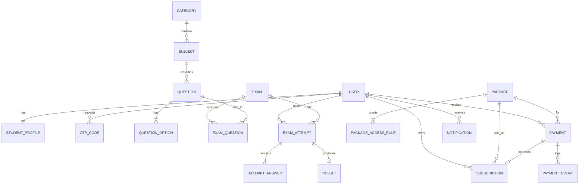

# Database Design — Online MCQ Examination Platform (Phase-1)

> Status: **Planning document.** Field lists are a design proposal; final names/types are fixed
> when Django models are written. Database: **PostgreSQL** (single, centralized).

---

## 1. Design principles

1. **PostgreSQL is the source of truth.** Clients never store authoritative data.
2. **Let the database enforce rules where it can:** `UNIQUE`, `CHECK`, `FOREIGN KEY`,
   `NOT NULL`. App-level validation is the first guard; DB constraints are the last guard.
3. **Money is `NUMERIC(12,2)`** (Django `DecimalField`) — never float.
4. **Marks are `NUMERIC(7,2)`** — negative marks like 0.25 must be exact.
5. **All timestamps `timestamptz` in UTC.**
6. **Every table has** `id` (BIGINT identity), `created_at`, `updated_at` (from a shared abstract
   base model). Public-facing identifiers that appear in URLs/payments use a `public_id` UUID
   so sequential IDs are not guessable where it matters (attempts, payments).
7. **Soft delete** (`is_active` / `deleted_at`) for content that past results depend on
   (questions, exams, packages). Hard delete only when nothing references the row.
8. **Snapshot what the past depends on.** An attempt stores the marks and order it was taken
   with, so later edits to an exam do not silently change old results.
9. **Designed for future expansion:** nullable FKs and enum fields that can grow
   (e.g. more payment providers, more roles) without schema rewrites.
10. **Bilingual content (Bangla + English).** Every admin-entered, user-visible text field is
    stored as a **pair of columns**: `<field>_bn` and `<field>_en` (see §2a).

---

## 2a. Bilingual field convention

| Rule | Detail |
|---|---|
| Naming | `name_bn` / `name_en`, `text_bn` / `text_en`, … In the tables below a field written as **`title`🌐** means *two columns* `title_bn` + `title_en`. |
| Required-ness | At least **one** of the pair is required (`CHECK (coalesce(title_bn,'') <> '' OR coalesce(title_en,'') <> '')`). Both may be required by business rules (e.g. `both`-language exams at publish time). |
| Fallback | API returns the requested language, falling back to the other if empty. |
| Normalization | All text NFC-normalized before save; digits stored as Western digits in numeric fields. |
| Search | `pg_trgm` GIN indexes on `*_bn` and `*_en` for the question bank (no Bangla stemmer in PostgreSQL FTS). |
| Slugs | ASCII only (from English title or admin-entered). |
| Not translated | Identifiers, numbers, money, timestamps, enum codes (enums are translated by the clients/`gettext`, never stored as display text). |

**Why paired columns instead of a separate translation table or JSON?**
- Exactly two languages are required → simplest queries, normal DB constraints and indexes per language.
- Easy for admins: two inputs/tabs per field.
- A third language later = add columns via migration (or switch to `django-modeltranslation`, which uses
  the same column pattern). Translation tables are more flexible but add a join to every content query —
  not worth it for two fixed languages.

Full localization rules: `LOCALIZATION.md`.

---

## 2. Entity overview (by module)

| Module | Tables |
|---|---|
| accounts | `users`, `student_profiles` |
| verification | `otp_codes`, `verification_tokens` |
| catalog | `categories`, `subjects` |
| questions | `questions`, `question_options` |
| exams | `exams`, `exam_questions` |
| attempts | `exam_attempts`, `attempt_answers` |
| results | `results` |
| subscriptions | `packages`, `package_access_rules`, `subscriptions` |
| payments | `payments`, `payment_events` |
| cms | `site_settings`, `announcements`, `faqs`, `pages`, `contact_messages` |
| notifications | `notifications` |
| audit | `audit_logs` |

(Table names shown without the Django app prefix for readability.)

---

## 3. Relationship diagram

```
users 1──1 student_profiles
otp_codes 1──0..1 verification_tokens   (no FK to users: an OTP exists before the user does)

categories 1──* subjects 1──* questions 1──* question_options
   (academic structure: Category → Subjects → Questions; a subject belongs to exactly one category)

categories 1──* exams            subjects 0..1──* exams
exams *──* questions   (through exam_questions: order, marks override)

users 1──* exam_attempts *──1 exams
exam_attempts 1──* attempt_answers *──1 questions
attempt_answers *──0..1 question_options (selected option)
exam_attempts 1──1 results

packages 1──* package_access_rules ──► (all paid exams | selected categories | selected exams)
users 1──* subscriptions *──1 packages
subscriptions 0..1──1 payments (the payment that created it)
users 1──* payments *──1 packages
payments 1──* payment_events

users 1──* notifications            (in-app only in Phase-1)
users 0..1──* audit_logs (actor)
contact_messages (standalone, from website contact form)
```



---

## 4. Tables in detail

Legend: **PK** primary key, **FK** foreign key, **U** unique, **IDX** indexed, `?` nullable.

### 4.1 accounts

#### `users` (custom Django user model — must be created before the first migration)
| Field | Type | Notes |
|---|---|---|
| id | bigint PK | |
| mobile_number | varchar(20) U **NOT NULL** | **mandatory**; E.164 normalized, e.g. `+8801XXXXXXXXX`; the login identifier |
| email | varchar(254)? U | **optional**; lower-cased; unique when present |
| full_name | varchar(150) | |
| password | varchar(128) | Django hash (Argon2/PBKDF2) — never plain text |
| role | varchar(20) | `student` \| `admin` (room for `staff`/`moderator` later) |
| preferred_language | varchar(5) | `bn` \| `en` — UI language (students & admins); default from site settings |
| is_active | bool | admin can deactivate |
| is_mobile_verified | bool | *(added in Milestone 2B with OTP verification)* always true for students (account is only created after SMS OTP succeeds); kept for admin accounts / future mobile number change |
| is_email_verified | bool | |
| auth_version | int | default 1; incremented on password reset/change — JWTs carry it, so old tokens stop working immediately |
| is_staff / is_superuser | bool | Django internals; superuser only for ops |
| last_login, date_joined | timestamptz | |

Constraints: `UNIQUE(mobile_number)`; partial `UNIQUE(lower(email)) WHERE email IS NOT NULL`.

> Why a custom user model? Django's default uses `username`. We log in by **mobile number**
> (`USERNAME_FIELD = "mobile_number"`).
> Changing the user model after the first migration is very painful, so it is decided now.

#### `student_profiles`
| Field | Type | Notes |
|---|---|---|
| user_id | FK → users, U | one-to-one |
| avatar | image path? | |
| institution | varchar? | |
| district | varchar? | optional |
| display_name | varchar(60)? | optional public nickname used by leaderboards when the platform's name mode is `display_name` |
| date_of_birth | date? | optional |

### 4.2 verification

#### `otp_codes` (model `OtpCode`)
| Field | Type | Notes |
|---|---|---|
| id | bigint PK | |
| mobile_number | varchar(20) | normalized `+8801XXXXXXXXX` (no FK to users — the module never reveals whether an account exists) |
| purpose | varchar | `registration` \| `password_reset` |
| otp_hash | varchar(64) | keyed HMAC-SHA256 of `mobile|purpose|code`, written by the SMS worker that generates the code (empty until then) — the code itself is never stored |
| language | varchar(5) | language the SMS was sent in (`bn` SMS = Unicode, 70 chars/segment) |
| expires_at | timestamptz | now + `OTP_TTL_SECONDS` |
| used_at | timestamptz? | set once verified — single use |
| invalidated_at | timestamptz? | set when a newer code is issued for the same number + purpose |
| failed_attempts | smallint | wrong tries; locked at `OTP_MAX_ATTEMPTS` |
| request_ip | inet? | for abuse tracking |
| created_at / updated_at | timestamptz | `created_at` = request time |

Index: `(mobile_number, purpose, created_at DESC)` for "latest OTP" lookups and resend cooldowns.

#### `verification_tokens` (model `VerificationToken`)
Issued once after a correct OTP; consumed by registration / password reset (Milestone 2C).

| Field | Type | Notes |
|---|---|---|
| token_hash | varchar(64) U | SHA-256 of a 256-bit random token — the token itself is never stored |
| mobile_number | varchar(20) | the verified number |
| purpose | varchar | same values as `otp_codes.purpose` |
| otp_id | FK → otp_codes, U | the code that produced it |
| expires_at | timestamptz | now + `VERIFICATION_TOKEN_TTL_SECONDS` |
| used_at | timestamptz? | single use |

### 4.3 catalog

#### `categories` *(implemented in Milestone 3A — model `catalog.Category`)*
| Field | Type | Notes |
|---|---|---|
| name🌐 | varchar(120) | `name_bn`, `name_en` — NFC-normalized, trimmed, inner whitespace collapsed; `CHECK` at least one non-empty |
| slug | varchar(140) U | ASCII `^[a-z0-9]+(-[a-z0-9]+)*$` (`CHECK`); generated from `name_en` when left empty (numeric suffix on collision) |
| description🌐 | text | optional plain text (no HTML), max 2000 chars (validation); empty string when absent |
| parent_id | FK? → categories | *not implemented in Phase-1 (flat list); can be added later as a nullable column without breaking anything* |
| sort_order | int | `CHECK >= 0` |
| is_active | bool | default true |
| created_at / updated_at | timestamptz | |

Index `(is_active, sort_order)`.

#### `subjects` *(implemented in Milestone 3A — model `catalog.Subject`)*
| Field | Type | Notes |
|---|---|---|
| category_id | FK → categories **NOT NULL**, PROTECT | Phase-1 decision: one subject belongs to exactly one category |
| name🌐, description🌐 | | same rules as categories |
| slug | varchar(140) | same format; `UNIQUE(category_id, slug)` |
| sort_order, is_active, created_at, updated_at | | same as categories |

Index `(category_id, is_active, sort_order)`.

Delete rule: `PROTECT` — cannot delete a category that still has subjects/exams, or a subject that still has questions/exams;
admin must deactivate or move them first. The admin API answers `409 in_use`; the category row is locked
(`SELECT … FOR UPDATE`) during delete and subject create/move, so a concurrent subject cannot be orphaned.

### 4.4 questions

#### `questions`
| Field | Type | Notes |
|---|---|---|
| subject_id | FK → subjects | PROTECT. The category is **derived** via `subject.category` (no duplicate `category_id` column → no risk of a question whose category and subject disagree) |
| text🌐 | text | `text_bn`, `text_en`; sanitized rich text/plain |
| image | image path? | optional, language-neutral |
| explanation🌐 | text? | shown only after submission + result published |
| available_languages | varchar(5) | computed on save: `bn` \| `en` \| `both` — used to filter the bank and validate exams |
| difficulty | varchar? | `easy` \| `medium` \| `hard` (optional) |
| is_active | bool | soft delete |
| created_by | FK? → users | |

Indexes: `(subject_id)`, `(is_active)`, `(available_languages)`, trigram GIN on `text_bn` and `text_en`.

#### `question_options`
| Field | Type | Notes |
|---|---|---|
| question_id | FK → questions | CASCADE |
| text🌐 | text | `text_bn`, `text_en` — must cover the same languages as its question |
| image | image path? | optional |
| is_correct | bool | **never serialized to students before submission** |
| sort_order | smallint | default order |

Rules:
- Display labels (`A B C D` / `ক খ গ ঘ`) are generated by clients from display order — never stored.
- At least 2 options, **exactly one correct** (Phase-1 is single-answer MCQ).
  Enforced in the service layer + a partial unique index
  `UNIQUE (question_id) WHERE is_correct = true`.
- Editing the correct answer of a question already used in a submitted attempt is **blocked**
  (or requires explicit "re-evaluate" in a later phase) to keep results consistent.

### 4.5 exams

#### `exams`
| Field | Type | Notes |
|---|---|---|
| public_id | uuid U | |
| title🌐 | varchar | `title_bn`, `title_en` |
| slug | varchar U | ASCII |
| description🌐 / instructions🌐 | text? | shown before start |
| content_language | varchar(5) | `bn` \| `en` \| `both` — language(s) the questions are offered in; publish blocked if any assigned question lacks a required language |
| category_id | FK → categories | |
| subject_id | FK? → subjects | null = mixed-subject exam within the category; if set, must belong to `category_id` (service validation) |
| exam_type | varchar | `practice` \| `regular` \| `live` (scheduled) |
| access_type | varchar | `free` \| `paid` |
| status | varchar | `draft` \| `published` \| `unpublished` \| `archived` |
| duration_minutes | int | `CHECK > 0` |
| total_questions | int | expected count; publish blocked if assigned ≠ this |
| default_marks | numeric(7,2) | per question, default 1.00 |
| negative_marks | numeric(7,2) | per wrong answer, default 0, `CHECK >= 0` |
| pass_marks | numeric(7,2)? | null = no pass/fail |
| start_at / end_at | timestamptz? | window for scheduled/live exams; `CHECK end_at > start_at`. **Late joiners on live exams only get time until `end_at`** |
| shuffle_questions | bool | |
| shuffle_options | bool | |
| allow_retake | bool | regular: admin-configurable (default false); practice: default true; **live: always false** |
| max_attempts | int? | used when `allow_retake = true`; null = unlimited. Live = 1 (enforced), regular default 1, practice default null. `CHECK (max_attempts IS NULL OR max_attempts >= 1)` |
| merit_enabled | bool | default true for live/regular, false for practice |
| merit_strategy | varchar | which attempt counts for merit: `first_attempt` \| `best_attempt` \| `latest_attempt`. **Live: always `first_attempt`** (the single submitted attempt). Regular: admin-configurable, default `first_attempt` |
| result_visibility | varchar | `immediate` \| `after_exam_end` \| `manual` |
| result_published_at | timestamptz? | set when admin publishes (manual mode) |
| allow_answer_review | bool | show correct answers/explanations after result is visible |
| is_featured | bool | for home page / website |
| created_by | FK? → users | |

Indexes: `(status, start_at)`, `(category_id, status)`, `(access_type)`.

#### `exam_questions` (join table)
| Field | Type | Notes |
|---|---|---|
| exam_id | FK → exams | CASCADE |
| question_id | FK → questions | PROTECT |
| sort_order | int | default order when not shuffled |
| marks | numeric(7,2)? | override; null = exam.default_marks |

`UNIQUE(exam_id, question_id)`.
Editing questions of an exam that already has attempts is blocked (admin must duplicate the exam).

### 4.6 attempts (exam engine)

#### `exam_attempts`
| Field | Type | Notes |
|---|---|---|
| public_id | uuid U | used in URLs |
| exam_id | FK → exams | PROTECT |
| user_id | FK → users | PROTECT |
| attempt_no | int | 1, 2, 3… |
| status | varchar | `in_progress` \| `submitted` \| `auto_submitted` \| `cancelled` |
| started_at | timestamptz | server time |
| deadline_at | timestamptz | server-computed: `min(started_at + duration, exam.end_at)` — so a late joiner on a live exam gets only the time left until the global end |
| submitted_at | timestamptz? | |
| submit_source | varchar? | `manual` \| `client_timeout` \| `server_auto` |
| client_info | jsonb? | app version, platform (debug/support) |
| content_language | varchar(5) | language last selected in the exam room (`both` exams); display only — scoring is language-independent |
| idempotency_key | varchar? | last accepted submit key |

Constraints / indexes:
- `UNIQUE(exam_id, user_id, attempt_no)` — no duplicate attempt numbers.
- Partial unique: `UNIQUE(exam_id, user_id) WHERE status = 'in_progress'` — only **one open
  attempt** per user per exam (prevents double-start from two devices).
- `IDX(status, deadline_at)` — for the auto-finalize job.

#### `attempt_answers` (one row per question in the attempt, created at start)
| Field | Type | Notes |
|---|---|---|
| attempt_id | FK → exam_attempts | CASCADE |
| question_id | FK → questions | PROTECT |
| display_order | int | order shown to this student (shuffled or not) |
| option_order | jsonb | list of option IDs in the order shown to this student |
| marks | numeric(7,2) | **snapshot** of marks at start |
| negative_marks | numeric(7,2) | **snapshot** |
| selected_option_id | FK? → question_options | null = unanswered |
| is_marked_for_review | bool | |
| answered_at | timestamptz? | server time when the answer was saved |
| client_saved_at | timestamptz? | device time of the change (for ordering retried saves; never used for timing decisions) |
| is_correct | bool? | filled **only at scoring time** |
| awarded_marks | numeric(7,2)? | filled at scoring time (+marks / −negative / 0) |

`UNIQUE(attempt_id, question_id)`. Service validates `selected_option.question_id == question_id`.

### 4.7 results

#### `results`
| Field | Type | Notes |
|---|---|---|
| attempt_id | FK → exam_attempts, U | one-to-one |
| exam_id, user_id | FK | denormalized for fast merit queries |
| total_questions | int | |
| correct_count / wrong_count / unanswered_count | int | |
| positive_marks | numeric(7,2) | |
| negative_marks_total | numeric(7,2) | |
| obtained_marks | numeric(7,2) | may be negative |
| total_marks | numeric(7,2) | |
| percentage | numeric(5,2) | obtained / total × 100 (clamped at display, raw stored) |
| is_passed | bool? | null when exam has no pass mark |
| time_used_seconds | int | `submitted_at − started_at`, capped at duration |
| merit_position | int? | filled by merit generation |
| is_merit_counted | bool | true on the **one** result per (exam, user) chosen by the exam's `merit_strategy`. Partial unique index `UNIQUE(exam_id, user_id) WHERE is_merit_counted` |
| calculated_at | timestamptz | |

Indexes: `(exam_id, is_merit_counted, obtained_marks DESC, time_used_seconds ASC, submitted_at ASC)`
— this is the **basic merit ordering**: higher marks first, then less time, then earlier submit.

**How configurable merit works without schema changes:** every attempt keeps its own `results` row.
The merit service simply moves the `is_merit_counted` flag:
- `first_attempt` → the earliest submitted result (live exams always use this; there is only one attempt)
- `best_attempt` → the highest `obtained_marks` (ties → less time → earlier)
- `latest_attempt` → the most recent submitted result
Changing an exam's strategy = re-run the merit service; no migration. New strategies (e.g. average)
can be added the same way.

Result **visibility** is not a column here — it is derived from `exams.result_visibility`,
`exams.end_at` and `exams.result_published_at`.

### 4.8 subscriptions

#### `packages`
| Field | Type | Notes |
|---|---|---|
| name🌐 | varchar | `name_bn`, `name_en` |
| slug | varchar U | ASCII |
| description🌐 | text | |
| features🌐 | jsonb? | short bullet list per language for pricing cards |
| price | numeric(12,2) | `CHECK >= 0` |
| currency | char(3) | `BDT` |
| validity_days | int | `CHECK > 0` |
| status | varchar | `active` \| `inactive` |
| sort_order, is_featured | | |

#### `package_access_rules`
| Field | Type | Notes |
|---|---|---|
| package_id | FK → packages | CASCADE |
| rule_type | varchar | `all_paid_exams` \| `category` \| `exam` — one row per selected category / exam, so a package can grant all paid exams, **selected categories** or **selected exams** (or a mix) |
| category_id | FK? → categories | when rule_type = category |
| exam_id | FK? → exams | when rule_type = exam |

`CHECK` that the right FK is set for each rule_type.
Access check: *"user can open paid exam E if they have an active subscription whose package has a
rule matching E (all paid, E's category, or E itself)."*

#### `subscriptions`
| Field | Type | Notes |
|---|---|---|
| user_id | FK → users | |
| package_id | FK → packages | PROTECT |
| payment_id | FK? → payments, U | the payment that created it; null if granted manually by admin |
| status | varchar | `active` \| `expired` \| `cancelled` |
| starts_at / expires_at | timestamptz | |
| price_paid | numeric(12,2) | snapshot |

Index: `(user_id, status, expires_at)`.
Renewal policy (assumption): buying the same package while active **extends** `expires_at`
from the current expiry; a different package creates a parallel subscription.

### 4.9 payments

#### `payments`
| Field | Type | Notes |
|---|---|---|
| public_id | uuid U | |
| merchant_reference | varchar U | our own transaction ID sent to provider |
| user_id | FK → users | PROTECT |
| package_id | FK → packages | PROTECT |
| provider | varchar | `mock` \| `sslcommerz` (**first implementation**) \| `bkash` \| `nagad` (added later through the same gateway interface — no schema change) |
| amount | numeric(12,2) | copied from package price **at initiation** |
| currency | char(3) | |
| status | varchar | `initiated` \| `pending` \| `success` \| `failed` \| `cancelled` |
| provider_payment_id | varchar? | provider's session/payment ID |
| provider_transaction_id | varchar? U | provider's final transaction ID — SSLCommerz `bank_tran_id`/`val_id`, bKash `trxID`, Nagad `issuerPaymentRefNo` (unique when present) |
| verified_at | timestamptz? | when server-side verification succeeded |
| failure_reason | varchar? | |
| raw_verification | jsonb? | provider verify response (secrets stripped) |

Indexes: `(user_id, created_at DESC)`, `(status, created_at)` for reconciliation job.
Status may only move forward: `initiated → pending → success|failed|cancelled` (enforced in service).

#### `payment_events` (append-only log)
| Field | Type | Notes |
|---|---|---|
| payment_id | FK → payments | |
| event_type | varchar | `initiated`, `callback_received`, `verify_request`, `verify_response`, `status_changed` |
| payload | jsonb | sanitized |
| source_ip | inet? | |

### 4.10 cms (basic settings & public content)

#### `site_settings` (single row)
platform_name🌐, logo, tagline🌐, app_download_url (Play Store), contact_email, contact_phone,
address🌐, social links (jsonb), about_content🌐, **default_language** (`bn`|`en`),
**public_leaderboard_name_mode** and **app_leaderboard_name_mode**
(`masked` default \| `initials` \| `display_name` \| `full_name`; phone/email are never shown),
plus **business config** jsonb
(e.g. `otp_expiry_seconds`, `otp_resend_cooldown_seconds`, `submit_grace_seconds`) with code defaults.

#### `announcements`
| Field | Type | Notes |
|---|---|---|
| title🌐 | varchar | |
| body🌐 | text | sanitized |
| audience | varchar | `public` \| `students` \| `all` |
| is_pinned | bool | |
| published_at | timestamptz? | null = draft |
| expires_at | timestamptz? | |

#### `contact_messages` (website contact form)
| Field | Type | Notes |
|---|---|---|
| name | varchar(120) | |
| phone | varchar(20)? | at least one of phone/email required |
| email | varchar(254)? | |
| subject | varchar(150) | |
| message | text | plain text only, length-limited |
| language | varchar(5) | language of the website page used |
| status | varchar | `new` \| `read` \| `resolved` |
| handled_by | FK? → users | admin who handled it |
| ip_address | inet? | abuse tracking; rate-limited |

Admins read these in the Admin Panel (email forwarding is a future extension).

#### `faqs`
question🌐, answer🌐, sort_order, is_active.

#### `pages` (optional, simple)
slug (`about`, `terms`, `privacy`), title🌐, body🌐. Kept minimal — a full CMS is Phase-2.

### 4.11 notifications (in-app only in Phase-1; push/SMS/email are future channels)

#### `notifications` (in-app, per user)
| Field | Type | Notes |
|---|---|---|
| user_id | FK → users | |
| type | varchar | template key: `result_published`, `payment_success`, `subscription_expiring`, `announcement` |
| params | jsonb | values for the template, incl. bilingual names, e.g. `{ "exam_id": 12, "exam_title_bn": "…", "exam_title_en": "…" }` |
| read_at | timestamptz? | |

Title/body are **rendered at read time** from localized templates in the user's current language,
so switching language also translates old notifications.
Index: `(user_id, read_at, created_at DESC)`.
Phase-1 decision: **in-app notifications only**. Push/SMS/email delivery can be added later as
extra channels that read the same `notifications` rows — no schema redesign.

### 4.12 audit

#### `audit_logs` (append-only) *(implemented in Milestone 3A — model `audit.AuditLog`)*
| Field | Type | Notes |
|---|---|---|
| actor_id | FK? → users, PROTECT | who did it; users with audit history cannot be hard-deleted (deactivate instead) |
| action | varchar(64) | e.g. `category.create`, `subject.delete`; later `exam.publish`, `question.update`, `payment.manual_update`… |
| entity_type / entity_id | varchar(64) | e.g. `catalog.category` / `12` (string, so UUID ids fit later) |
| summary | varchar(255) | identity of the object at that moment (survives deletes) |
| metadata | jsonb | safe details only: changed field names, before/after of short identity fields, delete snapshot. Never request payloads; keys like password/token/secret/otp are redacted |
| ip_address | inet? | from the trusted-proxy-aware client IP helper |
| user_agent | varchar(255) | |
| created_at | timestamptz | |

Indexes `(entity_type, entity_id)`, `(actor_id, created_at)`, `(action)`, `(created_at)`.
Append-only: a PostgreSQL trigger rejects `UPDATE`/`DELETE`; the model/queryset refuse them; no API or
Django-admin path can change a row. Entries are written in the same transaction as the change.

---

## 5. Key integrity rules summary

| Rule | How enforced |
|---|---|
| One open attempt per user per exam | Partial unique index |
| No duplicate final submission | Row lock (`SELECT … FOR UPDATE`) + status check + one-to-one `results.attempt_id` |
| One correct option per question | Partial unique index + service validation |
| Selected option belongs to the question | Service validation |
| Payment can't be verified twice | Unique `provider_transaction_id` + status transition check in a transaction |
| Subscription only from verified payment | `subscriptions.payment_id` unique; created inside the verification transaction |
| One merit-counted result per user per exam | Partial unique index on `results` |
| Live exam = one attempt | Service rule + `max_attempts = 1` enforced on save |
| Old results unaffected by edits | Snapshots in `attempt_answers`; edit locks on used questions/exams |
| Money/marks exact | `NUMERIC` types |
| Every content field has at least one language | `CHECK` per bilingual pair + service validation |
| `both`-language exam fully translated | Publish-time validation in `exams.services` |

---

## 6. Scoring formula (server-side)

For each `attempt_answer`:
- unanswered → `awarded = 0`
- selected option is correct → `awarded = marks`
- selected option is wrong → `awarded = −negative_marks`

```
obtained_marks = Σ awarded
total_marks    = Σ marks
percentage     = obtained_marks / total_marks × 100
is_passed      = obtained_marks ≥ pass_marks   (null if no pass_marks)
time_used      = min(submitted_at, deadline_at) − started_at
```

---

## 7. Indexing & growth notes

- Biggest growth tables: `attempt_answers` (≈ questions × attempts) and `results`.
  Example: 5,000 students × 20 exams × 100 questions = 10M rows — fine for PostgreSQL with the
  indexes above. Partitioning is a Phase-2 concern.
- Leaderboard queries read `results` only (denormalized `exam_id`, `user_id`).
- Use `select_related` / `prefetch_related` in DRF views to avoid N+1 queries.

---

## 8. Migrations policy

- Every model change → a reviewed Django migration committed with the code.
- No manual SQL changes on production databases.
- Data migrations for seed data (default site settings row) are allowed and versioned.
